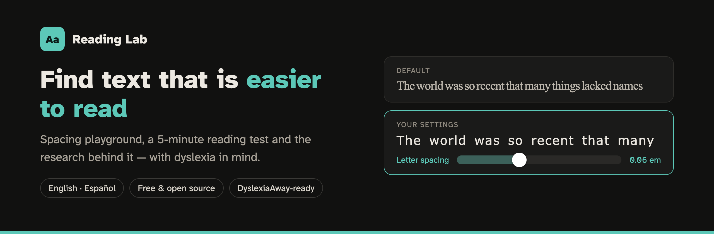
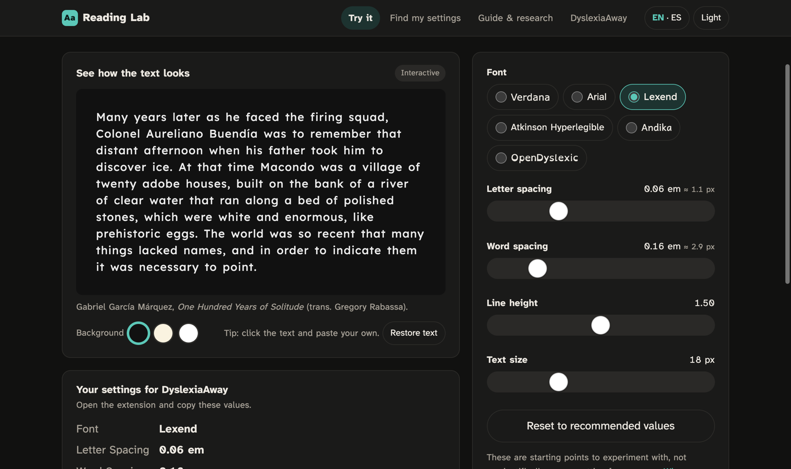
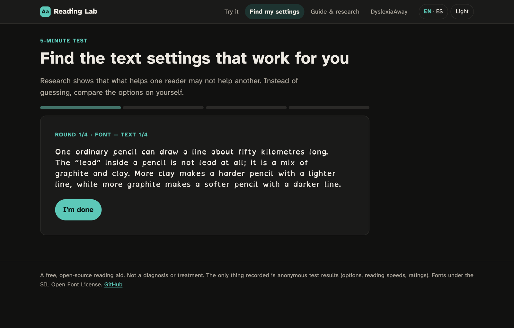
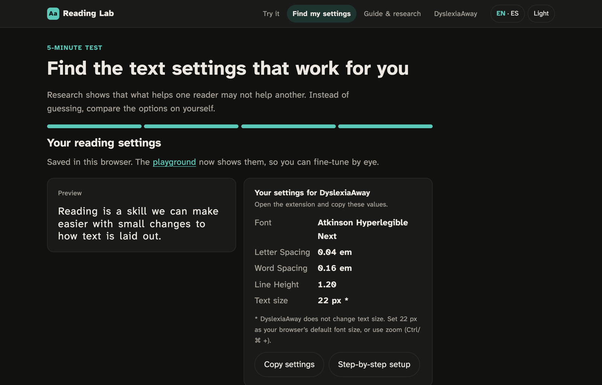
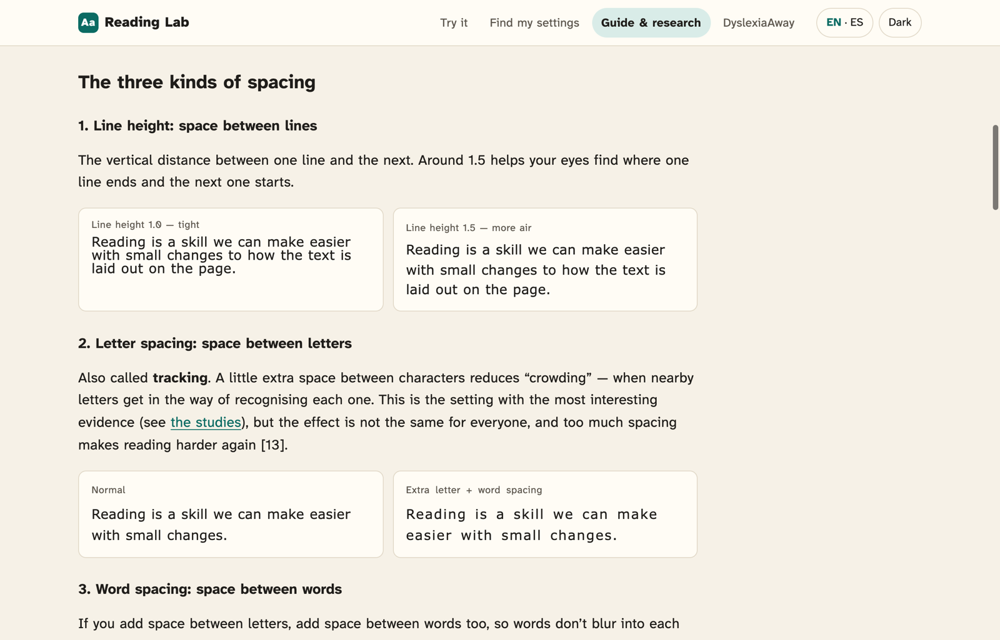

<p align="center">
  <a href="https://nifalconi.github.io/dyslexia-reading-lab/"></a>
</p>

<p align="center">
  <a href="https://nifalconi.github.io/dyslexia-reading-lab/"></a>
  
  <a href="LICENSE"></a>
  
</p>

<p align="center">
  <a href="https://nifalconi.github.io/dyslexia-reading-lab/"><b>Try it</b></a> ·
  <a href="https://nifalconi.github.io/dyslexia-reading-lab/test.html"><b>Take the 5-minute test</b></a> ·
  <a href="https://nifalconi.github.io/dyslexia-reading-lab/guide.html"><b>Read the research</b></a> ·
  <a href="https://nifalconi.github.io/dyslexia-reading-lab/?lang=es"><b>Versión en español</b></a>
</p>

---

**Reading Lab** is a small website for people with dyslexia — and anyone who finds dense text tiring. It helps you find the **font, letter spacing, word spacing, line height and size** that make reading easier *for you*, then apply them to every website with the free [DyslexiaAway](https://github.com/ernvk23/dyslexia-away) browser extension.

> [!NOTE]
> The research is fairly clear on one point: **spacing and size are worth adjusting, special “dyslexia fonts” mostly are not, and what helps one reader may not help another.** So instead of one “correct” setting, Reading Lab lets you test them on yourself.

## What’s inside

<table>
  <tr>
    <td width="50%" valign="top">
      <a href="https://nifalconi.github.io/dyslexia-reading-lab/"></a>
      <h3>1 · Try it</h3>
      A live preview. Switch between six fonts and move the sliders for letter spacing, word spacing, line height and size, on a dark, cream or white background. Paste in your own text. A box shows the exact values to type into DyslexiaAway.
    </td>
    <td width="50%" valign="top">
      <a href="https://nifalconi.github.io/dyslexia-reading-lab/test.html"></a>
      <h3>2 · Find my settings</h3>
      A 5-minute test: 13 short passages over four rounds — <b>font → spacing → line height → size</b>. It times each reading, asks one easy question so people don’t skim, and asks how easy it felt. Each round’s winner is used in the next.
    </td>
  </tr>
  <tr>
    <td width="50%" valign="top">
      
      <h3>3 · Your result</h3>
      Your settings are saved in the browser, previewed, and ready to copy into DyslexiaAway. A round-by-round breakdown shows speed and comfort for every option.
    </td>
    <td width="50%" valign="top">
      <a href="https://nifalconi.github.io/dyslexia-reading-lab/guide.html"></a>
      <h3>4 · Guide &amp; research</h3>
      The three kinds of spacing explained with side-by-side examples, what the studies found (and how sure we can be), a starting-point table and <b>16 references with checked DOIs</b>.
    </td>
  </tr>
</table>

Plus a **[DyslexiaAway page](https://nifalconi.github.io/dyslexia-reading-lab/extension.html)**: why we recommend it, what we checked in its source code (v1.14.1), its limits, and a step-by-step setup.

## A sensible starting point

| Setting | Start with | Why |
|---|---|---|
| Font | Verdana or Lexend (any clear sans-serif you like) | Upright sans-serif beats serif and italic; no special font beats ordinary ones on average |
| Size | 18 px or more | Larger text improved reading for readers with dyslexia |
| Line height | 1.5 | British Dyslexia Association and WCAG 1.4.12 |
| Letter spacing | +0.04 em, up to 0.12 em | Extra letter spacing reduced errors in several studies |
| Word spacing | +0.16 em — raise it *with* letter spacing | Wider letters without wider word gaps can slow reading |
| Alignment | Left, never justified | Even gaps between words |

These are starting points to experiment with, not a setting proven best for everyone. Sources and caveats are in the [guide](https://nifalconi.github.io/dyslexia-reading-lab/guide.html).

## How the test decides

For each option the score is **60 % relative reading speed + 40 % how easy it felt (1–5)**. A wrong answer to the comprehension question multiplies the speed part by 0.75, and readings faster than 600 words per minute count as skimmed. Options are shown in random order, each with a different passage, so close results can be noise; the result page says when two options were nearly tied.

This weighting is a pragmatic choice, not something taken from a study. It is meant to balance what research shows (preference and performance don’t always match) with what keeps people reading (comfort).

## Why DyslexiaAway

It has exactly the controls the research points to — separate letter spacing, word spacing and line height — instead of only swapping the font for OpenDyslexic. It is free, open source (GPL-3.0), makes no network requests and stores settings locally, and it works on Chrome, Edge, Firefox and Firefox for Android. Reading Lab uses the **same unit (em)** as the extension, so values copy across exactly.

Its limits are listed honestly on the [extension page](https://nifalconi.github.io/dyslexia-reading-lab/extension.html): no text-size control (use the browser setting), line height only on paragraphs and lists, and it is a small one-person project. *We are not affiliated with it.*

## Privacy and the data we collect

- The playground, guide and extension pages store your settings in `localStorage` only. No cookies, no analytics scripts, no Google Fonts — all fonts are self-hosted.
- The **test** keeps an anonymous progress log so we can learn which settings people prefer and where they give up. The page posts a row to a Google Form owned by the author when the test starts and after every text. Visitors never see the form.
- **What is sent:** options tried, winners of finished rounds, reading speeds, ease ratings, correct/incorrect, site language, phone or computer, and a random per-run session ID. **Never** a name, email, free text or anything identifying.
- **Reading the data:** all rows of one run share a `session`. The row with the highest `progress` shows how far that person got — `status = incomplete`, `progress = 6/13` means they stopped after the sixth text; `status = complete` means they finished.
- A one-line notice in the test intro and the footer says that anonymous results are recorded.

## Run it locally

No build step and no dependencies.

```sh
git clone https://github.com/nifalconi/dyslexia-reading-lab.git
cd dyslexia-reading-lab
python3 -m http.server 8000
# open http://localhost:8000  (add ?lang=es for Spanish)
```

```
index.html         Try it (playground)
test.html          Find my settings (test)
guide.html         Guide & research
extension.html     DyslexiaAway review & setup
assets/
  common.js        language, theme, saved settings, header/footer, DyslexiaAway box
  playground.js    playground logic
  test.js          test logic, scoring and the anonymous progress log
  passages.js      13 test passages + questions, in English and Spanish
  style.css        all styles
  fonts/           Lexend, Atkinson Hyperlegible Next, Andika, OpenDyslexic (SIL OFL)
  readme/          banner (banner.html is its source) and screenshots
```

When you change a CSS or JS file, bump the `?v=` number on the `<script>`/`<link>` tags so visitors don’t keep a cached copy.

## Contributing

Issues and pull requests are welcome, especially:

- corrections to the research summaries (please link the paper);
- better or more test passages, or new languages;
- accessibility problems on any device or screen reader.

## Important

Reading Lab is a reading aid. **It is not a dyslexia test, a diagnosis or a treatment.** If you think you or your child might be dyslexic, the British Dyslexia Association has [free checklists](https://www.bdadyslexia.org.uk/dyslexia/how-is-dyslexia-diagnosed/dyslexia-checklists) as a first step; a formal assessment is done by a qualified specialist.

## Credits

- Fonts, all under the SIL Open Font License: [Lexend](https://www.lexend.com/), [Atkinson Hyperlegible Next](https://www.brailleinstitute.org/freefont/) (Braille Institute), [Andika](https://software.sil.org/andika/) (SIL), [OpenDyslexic](https://opendyslexic.org/). The font files come from the [DyslexiaAway](https://github.com/ernvk23/dyslexia-away) repository, so the preview matches the extension.
- Sample text: the opening of *One Hundred Years of Solitude* / *Cien años de soledad* by Gabriel García Márquez (English translation by Gregory Rabassa), quoted briefly for demonstration.
- Research: see the [references](https://nifalconi.github.io/dyslexia-reading-lab/guide.html#en-refs).

## License

Code: [MIT](LICENSE). Fonts: SIL Open Font License 1.1 (see `assets/fonts/*-OFL.txt`).
